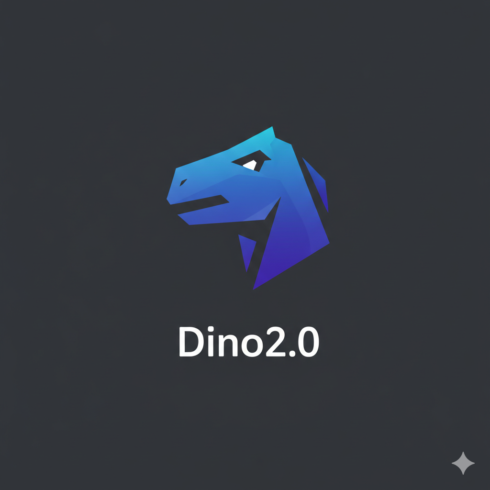

<p align="center">
  
</p>

<h1 align="center">🦕 Dino — Social Media Platform</h1>

<p align="center">
  <strong>A modern, full-featured social media web application built with Next.js 16, React 19, Supabase, and Tailwind CSS 4.</strong>
</p>

<p align="center">
  
  
  
  
  
  
</p>

---

## 📖 Table of Contents

- [Overview](#-overview)
- [Features](#-features)
- [Tech Stack](#-tech-stack)
- [Architecture](#-architecture)
- [Project Structure](#-project-structure)
- [Getting Started](#-getting-started)
  - [Prerequisites](#prerequisites)
  - [Installation](#installation)
  - [Environment Variables](#environment-variables)
  - [Running the Development Server](#running-the-development-server)
  - [Building for Production](#building-for-production)
- [Supabase Setup](#-supabase-setup)
- [Key Modules & Components](#-key-modules--components)
- [API Routes](#-api-routes)
- [Theming & Design System](#-theming--design-system)
- [Progressive Web App (PWA)](#-progressive-web-app-pwa)
- [Contributing](#-contributing)
- [License](#-license)

---

## 🌟 Overview

**Dino** is a full-stack social media platform that delivers a premium, Twitter/X-inspired experience with a sleek dark theme. It supports real-time messaging, community creation, friend management, voice/video calls via WebRTC, media sharing, notifications, and much more — all backed by **Supabase** for authentication, database, real-time subscriptions, and storage.

The app is designed as a **Progressive Web App (PWA)**, making it installable on any device and providing a native-like experience on mobile.

---

## ✨ Features

### 🔐 Authentication
- **Email/Password** sign-up and login with Supabase Auth
- **Email verification** flow with dedicated verification page
- **Forgot password** / password reset functionality
- Session persistence and automatic redirect for unauthenticated users

### 📝 Posts & Feed
- **Create posts** with rich text, images, and GIFs (powered by Giphy)
- **Like, comment, share, and bookmark** posts
- **Link previews** — automatic URL metadata extraction and preview cards
- **Post sharing modal** — share posts to friends or communities
- **Feed tabs** — switch between different feed views
- **Infinite scroll** post list with real-time updates

### 💬 Real-Time Chat
- **1-on-1 direct messaging** with real-time message delivery
- **Group chats** — create groups, add/remove members, admin controls
- **Media sharing** in chat — images, GIFs, and files
- **Link previews** within messages
- **Shared post previews** — forward posts directly into chat
- **Image clusters** — smart grouping of multiple images in conversations
- **Message read receipts** — track who has read messages
- **WhatsApp import** — import chat history from WhatsApp exports
- **Chat sidebar** with conversation list and search

### 📞 Voice & Video Calls
- **WebRTC-based** peer-to-peer voice and video calling
- **Call modal** with full call controls (mute, camera toggle, end call)
- **Incoming call listener** — ring notifications for incoming calls
- **Ring subset modal** — select specific group members to ring
- **Signaling** via Supabase real-time channels

### 👥 Friends System
- **Send, accept, and decline** friend requests
- **Friend search** — discover and find users
- **Friends list** with online status
- **Mutual connections** display

### 🏘️ Communities
- **Create communities** with custom name, description, and avatar
- **Community feed** — dedicated post feed per community
- **Member management** — view members, roles, and permissions
- **Community discovery** — browse and join public communities
- **Members rail** — sidebar showing community members

### 🔔 Notifications
- **Real-time notifications** for likes, comments, friend requests, mentions, etc.
- **Notification center** with grouped and categorized alerts
- **Mark as read** functionality

### 👤 User Profiles
- **Profile page** with bio, avatar, cover photo, and stats
- **Profile editing** — update display name, bio, and profile picture
- **Image cropper** — crop and resize profile/cover images before upload
- **Media grid** — gallery view of user's posted media
- **Profile settings** — account and privacy settings
- **Public user pages** (`/u/[username]`) for viewing other users

### 🔍 Explore & Discovery
- **Explore page** with trending posts and content
- **Bento grid layout** — visually appealing masonry-style content grid
- **Search functionality** across posts and users

### 📱 Mobile Experience
- **Fully responsive** design optimized for mobile devices
- **Mobile top bar** with quick actions
- **Mobile bottom navigation** — app-like tab bar
- **PWA installable** — add to home screen for native feel
- **Swipe gestures** via `react-swipeable`

### 📌 Bookmarks
- **Save posts** to personal bookmarks
- **Bookmarks page** for easy access to saved content

---

## 🛠️ Tech Stack

| Layer              | Technology                                                         |
| ------------------ | ------------------------------------------------------------------ |
| **Framework**      | [Next.js 16](https://nextjs.org/) (App Router)                    |
| **UI Library**     | [React 19](https://react.dev/)                                     |
| **Language**       | [TypeScript 5](https://www.typescriptlang.org/)                   |
| **Styling**        | [Tailwind CSS 4](https://tailwindcss.com/) + Custom Design Tokens |
| **Backend / BaaS** | [Supabase](https://supabase.com/) (Auth, Database, Storage, Realtime) |
| **Animations**     | [Framer Motion](https://www.framer.com/motion/)                   |
| **Icons**          | Heroicons, Lucide, Tabler Icons, Font Awesome, Remix Icons, MUI Icons |
| **GIFs**           | [Giphy SDK](https://developers.giphy.com/)                        |
| **Fonts**          | [Geist Sans & Geist Mono](https://vercel.com/font) via `next/font` |
| **PWA**            | [next-pwa](https://github.com/shadowwalker/next-pwa)              |
| **Real-Time Calls**| WebRTC (native browser API)                                        |
| **Image Editing**  | [react-easy-crop](https://github.com/ValentinH/react-easy-crop)   |
| **UI Components**  | [Headless UI](https://headlessui.com/), [MUI](https://mui.com/)   |

---

## 🏗️ Architecture

```
┌──────────────────────────────────────────────────────────┐
│                     Client (Browser)                     │
│  ┌─────────────┐ ┌──────────┐ ┌────────────────────────┐ │
│  │  Next.js    │ │  React   │ │  Framer Motion         │ │
│  │  App Router │ │  19 UI   │ │  Animations            │ │
│  └──────┬──────┘ └────┬─────┘ └────────────────────────┘ │
│         │              │                                  │
│  ┌──────┴──────────────┴──────────────────────────────┐  │
│  │              Supabase Client SDK                    │  │
│  │  (Auth · Database · Storage · Realtime · RPC)       │  │
│  └──────────────────────┬─────────────────────────────┘  │
│                         │                                 │
│  ┌──────────────────────┴─────────────────────────────┐  │
│  │              WebRTC (Peer-to-Peer Calls)            │  │
│  └─────────────────────────────────────────────────────┘  │
└──────────────────────────┬───────────────────────────────┘
                           │ HTTPS / WSS
┌──────────────────────────┴───────────────────────────────┐
│                   Supabase Cloud                          │
│  ┌──────────┐ ┌──────────┐ ┌──────────┐ ┌─────────────┐  │
│  │  Auth    │ │ Postgres │ │ Storage  │ │  Realtime   │  │
│  │  Service │ │ Database │ │  (S3)    │ │  (WebSocket)│  │
│  └──────────┘ └──────────┘ └──────────┘ └─────────────┘  │
└───────────────────────────────────────────────────────────┘
```

---

## 📂 Project Structure

```
Dino/
├── app/                          # Next.js App Router pages & API routes
│   ├── layout.tsx                # Root layout (fonts, metadata, PWA, ClientShell)
│   ├── page.tsx                  # Home / Dashboard (feed, sidebar, right rail)
│   ├── globals.css               # Global styles & Tailwind imports
│   ├── favicon.ico               # App favicon
│   │
│   ├── api/                      # Server-side API routes
│   │   ├── chats/                # Chat-related API endpoints
│   │   ├── communities/          # Community API endpoints
│   │   ├── link-preview/         # URL metadata extraction for link previews
│   │   └── posts/                # Post CRUD API endpoints
│   │
│   ├── login/                    # Login page
│   ├── signup/                   # Signup / registration page
│   ├── join/                     # Invite-based join page
│   ├── verify-email/             # Email verification page
│   ├── forgot-password/          # Password reset page
│   │
│   ├── feed/                     # Main feed page
│   ├── explore/                  # Explore / discover content
│   ├── bookmarks/                # Saved / bookmarked posts
│   ├── notifications/            # Notification center
│   │
│   ├── chat/                     # Real-time chat interface
│   ├── friends/                  # Friends management (list, requests, search)
│   ├── communities/              # Communities listing & detail pages
│   │   └── [id]/                 # Dynamic community detail page
│   │
│   ├── profile/                  # Current user's profile
│   │   ├── edit/                 # Profile editing page
│   │   └── settings/             # Account settings
│   │
│   ├── posts/                    # Individual post detail pages
│   └── u/                        # Public user profile pages (/u/[username])
│
├── components/                   # Reusable React components
│   ├── ClientShell.tsx           # Client-side wrapper (providers, global listeners)
│   │
│   ├── auth/                     # Authentication components
│   │   └── AuthForm.tsx          # Unified login/signup form
│   │
│   ├── dashboard/                # Dashboard layout components
│   │   ├── Sidebar.tsx           # Main navigation sidebar (desktop)
│   │   ├── RightRail.tsx         # Right sidebar (suggestions, trending)
│   │   ├── ComposerInline.tsx    # Inline post composer
│   │   ├── FeedTabs.tsx          # Feed filter tabs
│   │   └── Topbar.tsx            # Top navigation bar
│   │
│   ├── posts/                    # Post-related components
│   │   ├── PostCard.tsx          # Individual post card with interactions
│   │   ├── PostList.tsx          # Paginated post feed list
│   │   ├── PostComposer.tsx      # Full post creation form (text, media, GIFs)
│   │   ├── SharePostModal.tsx    # Modal to share posts to chats/communities
│   │   └── LinkPreview.tsx       # URL link preview card
│   │
│   ├── chat/                     # Chat components
│   │   ├── Sidebar.tsx           # Chat sidebar (conversation list)
│   │   ├── Composer.tsx          # Message composer (text, media, GIFs)
│   │   ├── MessageBubble.tsx     # Individual message bubble
│   │   ├── MessageList.tsx       # Scrollable message list
│   │   ├── ChatHeader.tsx        # Chat header with user/group info
│   │   ├── ChatPostPreview.tsx   # Post preview within chat
│   │   ├── SharedPostPreview.tsx # Shared post rendering in messages
│   │   ├── ImageCluster.tsx      # Multi-image layout in messages
│   │   ├── LinkPreview.tsx       # Link preview within chat messages
│   │   ├── GroupCreateModal.tsx   # Group chat creation modal
│   │   ├── GroupMembersModal.tsx  # Group members management modal
│   │   ├── WhatsAppImportModal.tsx # WhatsApp chat history importer
│   │   └── types.ts              # Chat-related TypeScript types
│   │
│   ├── call/                     # Voice/video call components
│   │   ├── CallModal.tsx         # Active call interface (controls, video)
│   │   ├── CallListener.tsx      # Incoming call detection & ringing
│   │   └── RingSubsetModal.tsx   # Select members to ring in group calls
│   │
│   ├── communities/              # Community components
│   │   ├── CommunitiesIndex.tsx   # Communities listing & discovery
│   │   ├── CreateCommunityModal.tsx # Community creation form
│   │   └── CommunityMembersRail.tsx # Community members sidebar
│   │
│   ├── friends/                  # Friends management components
│   │   ├── FriendsList.tsx       # Friends list display
│   │   ├── FriendSearch.tsx      # User search for adding friends
│   │   └── Requests.tsx          # Friend request management
│   │
│   ├── explore/                  # Explore page components
│   │   ├── ExploreGrid.tsx       # Explore content grid
│   │   └── BentoGrid.tsx         # Masonry-style bento grid layout
│   │
│   ├── profile/                  # Profile components
│   │   ├── ProfileView.tsx       # User profile display
│   │   └── ProfileMediaGrid.tsx  # User's media gallery grid
│   │
│   ├── mobile/                   # Mobile-specific components
│   │   ├── MobileTopbar.tsx      # Mobile top navigation bar
│   │   └── MobileBottomNav.tsx   # Mobile bottom tab navigation
│   │
│   └── ui/                       # Shared UI primitives
│       ├── Modal.tsx             # Reusable modal dialog
│       ├── Avatar.tsx            # User avatar component
│       └── ImageCropperModal.tsx # Image crop & resize modal
│
├── lib/                          # Utility libraries & business logic
│   ├── supabaseClient.ts         # Supabase client-side SDK initialization
│   ├── supabaseServer.ts         # Supabase server-side SDK initialization
│   ├── theme.ts                  # Centralized design tokens (Tailwind classes)
│   ├── posts.ts                  # Post CRUD operations & queries
│   ├── friends.ts                # Friend request & friendship logic
│   ├── notifications.ts          # Notification creation & retrieval
│   ├── chatAdmin.ts              # Chat/group administration logic
│   ├── calls.ts                  # Call session management
│   ├── signaling.ts              # WebRTC signaling helpers
│   ├── webrtc.ts                 # WebRTC peer connection management
│   ├── media.ts                  # Media upload & processing utilities
│   ├── storage.ts                # Supabase Storage helpers
│   ├── messageReads.ts           # Message read receipt tracking
│   ├── inviteCodes.ts            # Invite code generation & validation
│   └── whatsappParser.ts         # WhatsApp export file parser
│
├── types/                        # TypeScript type definitions
│   └── next-pwa.d.ts            # Type declarations for next-pwa
│
├── public/                       # Static assets
│   ├── dino_logo.png            # App logo
│   ├── manifest.json            # PWA manifest
│   ├── file.svg                 # File icon
│   ├── globe.svg                # Globe icon
│   ├── next.svg                 # Next.js logo
│   ├── vercel.svg               # Vercel logo
│   └── window.svg               # Window icon
│
├── next.config.ts                # Next.js configuration with PWA plugin
├── next.config.mjs               # Next.js ESM configuration
├── tsconfig.json                 # TypeScript configuration
├── postcss.config.mjs            # PostCSS configuration (Tailwind)
├── eslint.config.mjs             # ESLint configuration
├── package.json                  # Dependencies & scripts
├── package-lock.json             # Dependency lock file
└── .gitignore                    # Git ignore rules
```

---

## 🚀 Getting Started

### Prerequisites

Make sure you have the following installed on your machine:

- **Node.js** ≥ 18.x — [Download](https://nodejs.org/)
- **npm** ≥ 9.x (comes with Node.js)
- **Git** — [Download](https://git-scm.com/)
- A **Supabase** account — [Sign up free](https://supabase.com/)

### Installation

1. **Clone the repository:**

   ```bash
   git clone https://github.com/dubeysamiksha803-cell/Dino.git
   cd Dino
   ```

2. **Install dependencies:**

   ```bash
   npm install
   ```

### Environment Variables

Create a `.env.local` file in the root directory with the following variables:

```env
# Supabase Configuration
NEXT_PUBLIC_SUPABASE_URL=your_supabase_project_url
NEXT_PUBLIC_SUPABASE_ANON_KEY=your_supabase_anon_key
```

> **How to get these values:**
> 1. Go to your [Supabase Dashboard](https://app.supabase.com/)
> 2. Select your project (or create a new one)
> 3. Navigate to **Settings** → **API**
> 4. Copy the **Project URL** → `NEXT_PUBLIC_SUPABASE_URL`
> 5. Copy the **anon/public** key → `NEXT_PUBLIC_SUPABASE_ANON_KEY`

### Running the Development Server

```bash
npm run dev
```

Open [http://localhost:3000](http://localhost:3000) in your browser to see the app.

> The page auto-updates as you edit files thanks to Next.js Fast Refresh.

### Building for Production

```bash
npm run build
npm start
```

### Linting

```bash
npm run lint
```

---

## 🗄️ Supabase Setup

Dino relies on **Supabase** for its entire backend. You'll need to set up the following in your Supabase project:

### Database Tables

You'll need tables for the following entities (create these via the Supabase SQL Editor or Table Editor):

| Table                | Description                                      |
| -------------------- | ------------------------------------------------ |
| `profiles`           | User profiles (username, display name, bio, avatar, cover photo) |
| `posts`              | User posts (content, media URLs, timestamps)     |
| `comments`           | Post comments                                    |
| `likes`              | Post likes (user ↔ post mapping)                 |
| `bookmarks`          | Saved/bookmarked posts per user                  |
| `friendships`        | Friend relationships and request status          |
| `friend_requests`    | Pending friend requests                          |
| `chats`              | Chat rooms (DM and group)                        |
| `chat_members`       | Chat room membership                             |
| `messages`           | Chat messages (text, media, shared posts)         |
| `message_reads`      | Message read receipts                            |
| `communities`        | Community metadata (name, description, avatar)    |
| `community_members`  | Community membership and roles                   |
| `notifications`      | User notifications                               |
| `invite_codes`       | Invite codes for registration                    |
| `calls`              | Call session records                             |

### Storage Buckets

Create the following storage buckets in Supabase Storage:

- **`avatars`** — User profile pictures
- **`covers`** — Profile cover images
- **`post-media`** — Images and media attached to posts
- **`chat-media`** — Media shared in chat messages
- **`community-avatars`** — Community profile images

### Realtime

Enable **Realtime** on the following tables for live updates:
- `messages` — Real-time chat messaging
- `notifications` — Instant notification delivery
- `calls` — Call signaling
- `posts` — Live feed updates

### Row Level Security (RLS)

Enable RLS on all tables and create appropriate policies to ensure:
- Users can only read their own data and public content
- Users can only modify their own posts, profiles, and messages
- Chat messages are only visible to chat members
- Community content is only visible to community members

---

## 🧩 Key Modules & Components

### Authentication (`components/auth/AuthForm.tsx`)
A unified, reusable authentication form supporting both login and signup modes. Handles email/password input, form validation, error display, and redirects.

### Post System (`lib/posts.ts` · `components/posts/`)
The core content engine:
- **PostComposer** — Rich editor supporting text, image uploads, and GIF selection via the Giphy SDK
- **PostCard** — Full-featured post card with like, comment, share, and bookmark actions
- **PostList** — Paginated, real-time feed with infinite scroll
- **SharePostModal** — Share posts to friends via DM or to communities
- **LinkPreview** — Automatic URL metadata extraction and preview rendering

### Chat System (`app/chat/` · `components/chat/`)
A comprehensive real-time messaging system:
- Conversation sidebar with search and unread counts
- Message bubbles with timestamps, read receipts, and media
- Group chat creation and member management
- WhatsApp chat import parser
- Shared post previews within messages

### WebRTC Calls (`lib/webrtc.ts` · `lib/signaling.ts` · `components/call/`)
Peer-to-peer voice and video calling:
- WebRTC peer connection setup with STUN/TURN servers
- Supabase Realtime-based signaling for offer/answer/ICE exchange
- Call UI with camera/microphone toggles, picture-in-picture, and duration timer

### Friends (`lib/friends.ts` · `components/friends/`)
Complete friendship management including search, request sending/accepting/declining, and friends list display.

### Communities (`components/communities/`)
Community creation, discovery, and management with dedicated community feeds and member administration.

### Notifications (`lib/notifications.ts` · `app/notifications/`)
A notification system tracking likes, comments, friend requests, mentions, and more, with mark-as-read support.

---

## 🔌 API Routes

| Route                      | Method | Description                              |
| -------------------------- | ------ | ---------------------------------------- |
| `/api/posts/*`             | Various| Post CRUD operations                     |
| `/api/chats/*`             | Various| Chat and message operations              |
| `/api/communities/*`       | Various| Community management endpoints           |
| `/api/link-preview`        | GET    | Extract metadata from a URL for previews |

---

## 🎨 Theming & Design System

Dino uses a **centralized design token system** defined in [`lib/theme.ts`](lib/theme.ts):

| Token              | Purpose                              | Value                    |
| ------------------- | ------------------------------------ | ------------------------ |
| `APP_BG`           | App background                       | Pitch black (`bg-black`) |
| `CARD_PRIMARY`     | Primary card style                   | Dark card with subtle border |
| `TEXT_HEADING`     | Heading typography                   | White, semibold          |
| `TEXT_BODY`        | Body text                            | Light slate              |
| `ACCENT_PRIMARY`   | Primary accent color                 | Sky blue (`sky-400`)     |
| `ACCENT_SECONDARY` | Secondary accent color               | Emerald green (`emerald-400`) |
| `HOVER_BG`        | Interactive hover state              | Subtle white overlay     |

The design follows **Material Design** principles with a modern, minimalistic dark theme.

---

## 📱 Progressive Web App (PWA)

Dino is configured as a **PWA** using `next-pwa`:

- **Installable** — Users can add Dino to their home screen on mobile or desktop
- **Offline-capable** — Service worker caching for offline access (production only)
- **App manifest** — Custom app name, icons, theme color, and standalone display mode

The PWA configuration is in [`next.config.ts`](next.config.ts) and the manifest is at [`public/manifest.json`](public/manifest.json).

---

## 🤝 Contributing

Contributions are welcome! Here's how to get started:

1. **Fork** the repository
2. **Create** a feature branch:
   ```bash
   git checkout -b feature/amazing-feature
   ```
3. **Commit** your changes:
   ```bash
   git commit -m "feat: add amazing feature"
   ```
4. **Push** to your branch:
   ```bash
   git push origin feature/amazing-feature
   ```
5. **Open** a Pull Request

### Code Style

- Follow the existing code patterns and conventions
- Use TypeScript for all new files
- Run `npm run lint` before committing
- Use meaningful commit messages following [Conventional Commits](https://www.conventionalcommits.org/)

---

## 📄 License

This project is open source and available under the [MIT License](LICENSE).

---

<p align="center">
  Made with ❤️ by the Dino Team
</p>
